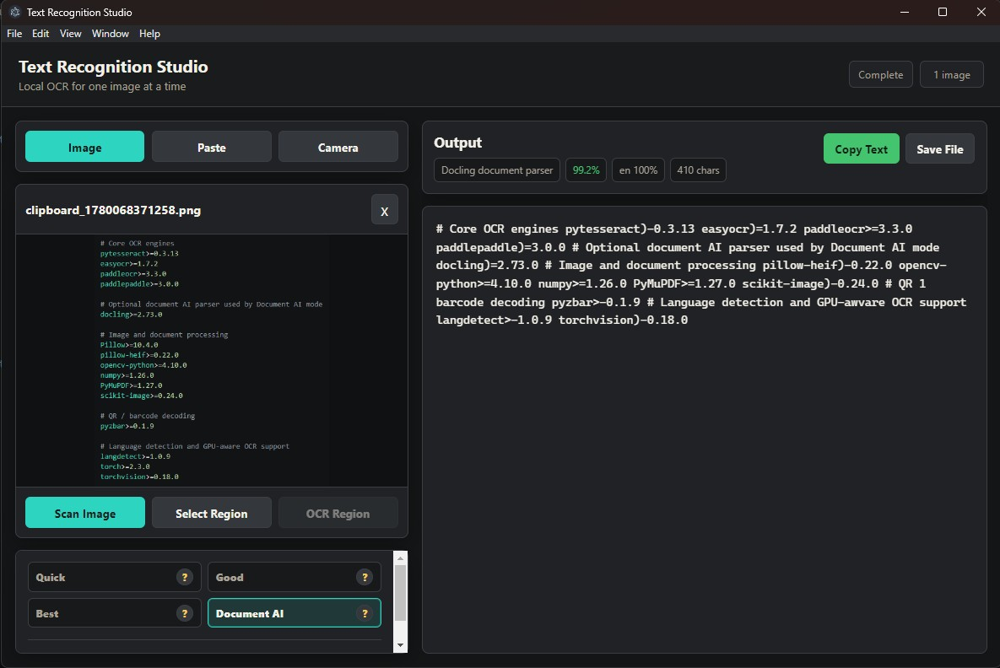

# Text Recognition Studio

Local Electron app for OCR, scanned PDFs, camera captures, QR/barcode decoding, layout-aware extraction, confidence review, and batch text export.



## What Changed

- Multi-input OCR for images, PDFs, and dragged folders.
- PDF rendering and scanned-PDF OCR through PyMuPDF.
- HEIC/HEIF support through `pillow-heif`.
- Camera capture and clipboard image OCR.
- Region OCR by drawing a box over the preview.
- QR and barcode payload extraction with `pyzbar` plus OpenCV QR fallback.
- Fast, Balanced, Best, and Document AI scan modes.
- Image cleanup before OCR: auto-rotate, deskew, crop borders, de-noise, contrast, sharpen, binarize, shadow reduction, and page boundary correction.
- Manual and post-OCR auto language detection, including multi-language OCR settings.
- Custom words and ignored warning words.
- Suspicious text review for low confidence words, odd symbols, common OCR confusions, missing punctuation, and broken wrapping.
- Output styles: plain text, line breaks, paragraphs, columns, tables, form fields, key-values, Markdown, and JSON.
- Copy actions for text, Markdown, tables, and JSON.
- Save the current output, OCR text, Markdown, tables, or JSON directly to files from the app.
- Export every available output format into a new folder in one pass.
- Create a ZIP bundle containing every available output format in one pass.
- Reveal the current source file or the latest saved export directly in Explorer.
- Local scan history sidebar with one-click restore and re-scan for recent work.
- History search, pin, rename, favorite, and delete controls for managing recent scans.
- Separate favorites shelf for keeping important outputs outside the rolling history list.
- History entries now show scan mode and output-style tags.
- Compare two history entries side by side to spot OCR differences line by line.
- Export comparison diffs directly as Markdown or JSON.
- CLI mode backed by the same Python OCR engine used by the app.

## OCR Stack

The app keeps OCR local:

- **PaddleOCR PP-OCRv5** is the preferred high-quality engine for Best and Balanced modes.
- **Tesseract** is the fastest baseline and the first engine in Fast mode.
- **EasyOCR** is used as a second opinion in Best mode.
- **Docling** is available in Document AI mode for structured document parsing, table structure, Markdown, and richer PDF layout extraction.
- **PyMuPDF** renders PDF pages to high-resolution images so scanned PDFs go through the same cleanup and OCR pipeline as images.

## Prerequisites

| Software      | Version    | Notes                                          |
| ------------- | ---------- | ---------------------------------------------- |
| Node.js       | 16+        | Electron shell                                 |
| Python        | 3.9 - 3.12 | 3.11 is a safe target for OCR packages         |
| Tesseract OCR | Current    | Needed for Fast mode and orientation detection |
| zbar          | Current    | Needed by `pyzbar` on macOS/Linux              |

### Tesseract

| Platform | Install                                                                  |
| -------- | ------------------------------------------------------------------------ |
| Windows  | Install from `UB-Mannheim/tesseract` to `C:\Program Files\Tesseract-OCR` |
| macOS    | `brew install tesseract`                                                 |
| Linux    | `sudo apt-get install tesseract-ocr`                                     |

### zbar

| Platform | Install                                  |
| -------- | ---------------------------------------- |
| Windows  | Usually included with the `pyzbar` wheel |
| macOS    | `brew install zbar`                      |
| Linux    | `sudo apt-get install libzbar0`          |

## Install

```sh
npm install
pip install -r requirements.txt
```

For NVIDIA GPU acceleration, install the PyTorch and PaddlePaddle GPU wheels that match your CUDA version, then run the app normally.

## Run

```sh
npm start
```

To create or repair `.venv` and install missing Python requirements before starting the app:

```sh
python src/python/launcher.py
```

Development mode:

```sh
npm run dev
```

## Package

Build a Windows portable release in `release/`:

```sh
npm run release
```

Build an unpacked app directory for local packaging checks:

```sh
npm run pack
```

The packaged app still uses local OCR dependencies. Install Python requirements and Tesseract on the target machine before running OCR-heavy modes.

## CLI

```sh
python src/python/ocr_engine.py receipt.jpg --mode best --output-style markdown
python src/python/ocr_engine.py scans/ --mode balanced --languages en,es --output-style json --raw-json
python src/python/ocr_engine.py report.pdf --mode document --use-docling --output-style markdown
```

Useful flags:

- `--mode fast|balanced|best|document`
- `--output-style plain|line_breaks|paragraphs|columns|tables|form_fields|key_values|markdown|json`
- `--languages en,es,fr`
- `--auto-language`
- `--region-json "{\"x\":0,\"y\":0,\"width\":500,\"height\":300,\"sourceWidth\":1000,\"sourceHeight\":800}"`
- `--no-codes`
- `--use-docling`

## Scan Modes

| Mode        | Behavior                                                        |
| ----------- | --------------------------------------------------------------- |
| Fast        | Tesseract first, Paddle fallback if needed                      |
| Balanced    | PaddleOCR first, Tesseract fallback                             |
| Best        | PaddleOCR, EasyOCR, and Tesseract are scored against each other |
| Document AI | Uses Docling when available, with OCR fallback                  |

## Output Styles

| Style       | Use                                                     |
| ----------- | ------------------------------------------------------- |
| Plain text  | Reflow everything into one text stream                  |
| Line breaks | Preserve source line breaks                             |
| Paragraphs  | Content-aware newline cleanup                           |
| Columns     | Read detected columns top-to-bottom                     |
| Tables      | Return detected table-like rows as Markdown             |
| Form fields | Return checkbox/blank-style fields                      |
| Key-values  | Return `Label: Value` pairs                             |
| Markdown    | Structured Markdown with codes, tables, pairs, and text |
| JSON        | Full structured payload                                 |

## Project Structure

```text
Text-Recognition/
  package.json
  requirements.txt
  README.md
  screenshot.jpg
  src/
    main/
      main.js
    renderer/
      index.html
      renderer.js
      styles.css
    python/
      ocr_engine.py
      launcher.py
```

## Troubleshooting

### Tesseract not found

Make sure `tesseract.exe` is installed in `C:\Program Files\Tesseract-OCR`, or add your install directory to `PATH`.

### `ImportError: Unable to find zbar shared library`

Install zbar for your platform, then reinstall `pyzbar` if needed.

### First scan is slow

PaddleOCR, EasyOCR, and Docling download or initialize model weights on first use.

### Document AI mode fails

Run:

```sh
pip install docling
```

Then retry with `--use-docling` or the app's Document AI mode.

## Privacy

OCR, QR/barcode decoding, preprocessing, and document parsing run locally on your machine.
